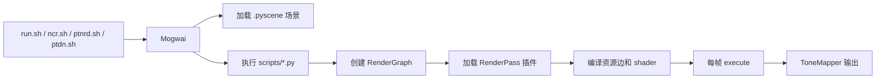
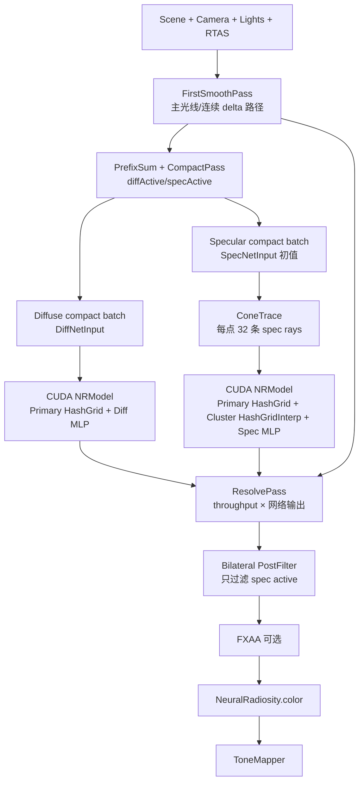
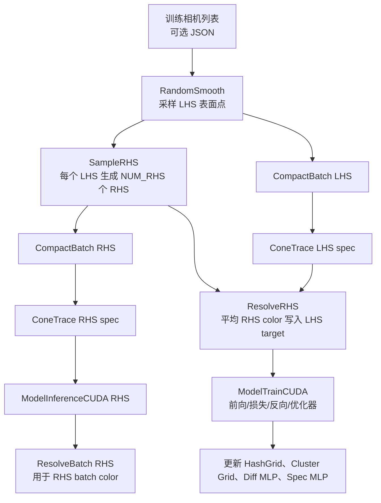
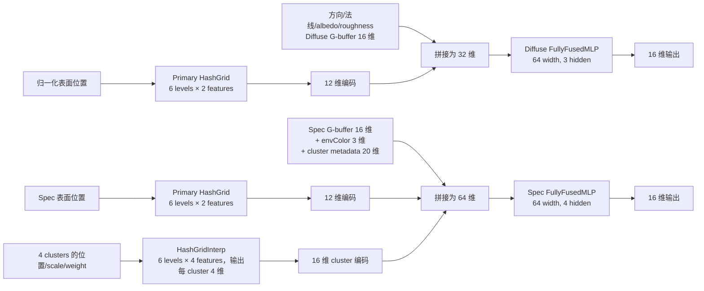
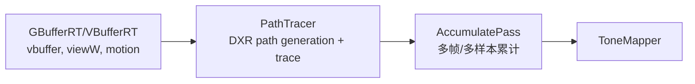
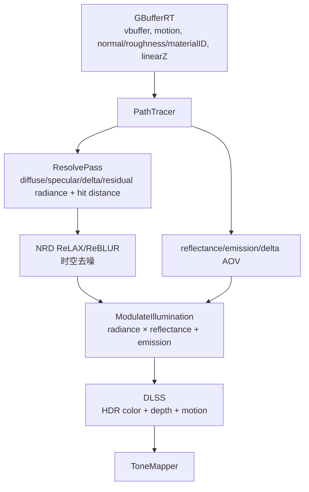
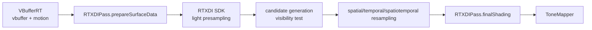

# Glossy GI 工程渲染与神经网络管线

本文以当前 checkout（`E:/GlossyGI/Falcor-stage3`，分支 `stage4dev`）的源码为准，说明从场景启动、RenderGraph 调度，到神经 Glossy GI 的训练/推理和传统参考渲染管线。流程图使用 Mermaid；代码路径均相对于仓库根目录。

## 1. 从启动到每帧执行



`run.sh` 是 Linux 统一入口，脚本名映射在 `run.sh` 的 `SCRIPTS` 表中；例如 `./run.sh ncr living-room anim` 会选择 `scripts/NeuralRadiosity.py` 和 `media/scenes/living-room/scene-animation.pyscene`。`ncr.sh`、`ptnrd.sh`、`ptdn.sh` 是固定分辨率 1280×720 的快捷启动器。Python 脚本只描述 RenderGraph，真正的 pass 由插件注册并由 Falcor 每帧调度。

场景提供相机、几何、材质、环境光、解析光源、发光三角形以及光线追踪加速结构。多数管线以 `VBufferRT`/`GBufferRT` 产生的可见性和运动数据为输入；`NeuralRadiosity` 是例外，它在自己的 `FirstSmoothPass` 中直接生成主光线和 G-buffer。

## 2. 工程中可运行的渲染图

| 脚本 | 顺序 | 作用 |
| --- | --- | --- |
| `NeuralRadiosity.py` | `NeuralRadiosity → ToneMapper` | 神经网络 Glossy/Diffuse GI；训练模式也由该 pass 内部切换。 |
| `PathTracer.py` | `VBufferRT → PathTracer → AccumulatePass → ToneMapper` | 普通路径追踪参考图。 |
| `PathTracerNRD.py` | `GBufferRT → PathTracer → NRD/ModulateIllumination → DLSS → ToneMapper`，另保留参考输出 | DirectX 风格的 NRD + DLSS 管线。 |
| `PathTracerNRD_VK.py` | `GBufferRT → PathTracer → NRD(ReBLUR) → ModulateIllumination → ToneMapper`，另保留参考输出 | Vulkan 变体，不经过 DLSS。 |
| `OptixDenoiser.py` | `GBufferRT + PathTracer(RTXDI) → AccumulatePass → OptixDenoiser → ToneMapper` | OptiX HDR 去噪参考图。 |
| `RTXDI.py` | `VBufferRT → RTXDIPass → AccumulatePass(关闭) → ToneMapper` | ReSTIR/RTXDI 直接光照。 |
| `MinimalPathTracer.py` | `VBufferRT → MinimalPathTracer → AccumulatePass → ToneMapper` | 用于验证的简单路径追踪器。 |
| `GBuffer.py` | `GBufferRT.normW → ToneMapper` | G-buffer 法线可视化。 |
| `BSDFViewer.py` | `BSDFViewer → AccumulatePass(Double)` | 材质/BSDF 预览。 |
| `WARDiffPathTracer.py` | `WARDiffPathTracer → 两路 AccumulatePass → ColorMapPass` | Warp/Area reparameterization 的可微渲染调试图。 |
| `SceneDebugger.py` | `SceneDebugger` | 场景调试输出。 |

## 3. NeuralRadiosity 的屏幕渲染管线



### 3.1 帧入口和资源

`NeuralRadiosity::execute()` 每帧依次完成：更新输出尺寸、准备发光光源采样器、按 shader defines 特化程序、创建/调整 batch buffer、可选地检查时间历史，然后按模式调用 `train()` 和/或 `render()`。没有场景时会清空所有输出。RenderGraph 暴露 `color`、`vbuffer`、`active`、`pos`、`dir`、`normal`、`albedo`、`roughness` 八个输出；当前 `scripts/NeuralRadiosity.py` 只把 `color` 接到 `ToneMapper`，其余通道仍可被调试图或外部 pass 连接。

### 3.2 `FirstSmoothPass`：主光线和首次平滑交互

输入是场景 RTAS、相机、材质/纹理、环境光和采样器，输出是屏幕大小的：

- `gVBuffer`：最后一次命中的 `PackedHitInfo`；
- `gColor`：路径吞吐量，或 miss/发光命中的环境/自发光颜色；
- `gPos/gDir/gNormal/gAlbedo/gRoughness`：首次非 delta 表面信息；
- `diffActive/specActive` 和对应的初始索引掩码。

每个像素最多递归 16 层。遇到 delta-only 材质会继续采样，直到 miss、发光、背面或首次非 delta 表面。有效表面按 `roughness > 0.5` 分到 Diffuse，`roughness <= 0.5` 分到 Specular；无效路径不会进入网络查询并保留早先的颜色。

### 3.3 `CompactPass`：按材质类别压紧屏幕样本

对两个 active mask 做 GPU prefix sum，得到 `diffSize` 和 `specSize`。随后只为有效元素写紧凑数组：

- Diffuse：位置先按场景 AABB 归一化到 `[0,1]^3`，连同方向、法线、反射率、粗糙度写入 `DiffNetInput`。
- Specular：保存像素坐标、V-buffer、位置、方向和粗糙度，并把位置、方向、法线、反射率、粗糙度写入 `SpecNetInput`；后续 `ConeTrace` 再补充 cluster 和环境颜色字段。

紧凑数组使 CUDA 网络只处理有效样本，而不是整张屏幕。

### 3.4 `ConeTrace`：Glossy 射线聚类

该 pass 只对 `specSize` 个样本执行，每个样本启动 `NUM_SPEC_RAYS` 条线程（渲染 32 条，训练 128 条）。线程从当前材质的 GGX/BSDF 分布采样并追踪一次射线；无效命中会被标记，最多尝试 10 次采样。所有距离使用整数化的 `rayT × 1e5` 做 K-means，默认 4 个 cluster，渲染迭代 3 次，训练迭代 10 次。

每个 cluster 写出：

```text
clusterPos   = surfacePos + meanDistance * reflectedDirection
clusterScale = (stdDistance + tanLobe(roughness) * meanDistance) / 2
clusterWeight = clusterCount / NUM_SPEC_RAYS
```

位置按场景 AABB 归一化。`envColor` 从预过滤环境 cubemap 读取；若 cubemap 无效则回退到原始环境图，否则回退为零。cluster 的四组位置、尺度和权重成为 SpecNet 的输入。

源码中还保留 Temporal Merge、Temporal-to-History 和 Screen-space Denoise 的逻辑，但 `temporalHistory` 的资源分配/绑定和 shader 内调用目前是注释状态；因此 UI 中的 temporal 选项不能证明当前帧真的使用了历史聚类。

### 3.5 CUDA 推理和 Resolve

`modelInferenceCUDA()` 先等待 Falcor GPU 队列，再在独立 CUDA inference stream 上执行 `NRModel::inference()`，最后等待 CUDA 完成。Diffuse 和 Specular 输入会原地执行 hash-grid 编码，再经过各自 MLP，输出 `NetworkOutput[16]`。

`ResolvePass` 对 active 像素执行：

```text
color = firstSmoothThroughput × NetworkOutput[0..3]
```

当前可见结果实际使用 RGB（以及第 4 个分量写入 alpha）；网络声明 16 维输出，但其余维度在 Resolve 中没有被消费。miss、发光和 inactive 像素不会走网络乘法。

### 3.6 空间后处理和最终输出

开启 `Post Filter` 时：

1. `PostFilterPass` 对 Specular 像素做 7×7 bilateral filter；空间、法线、albedo、颜色权重分别使用 `sigmaSpatial=4`、`sigmaNormal=0.05`、`sigmaAlbedo=0.02`、`sigmaColor=2`。
2. `mainFXAA` 根据 3×3 邻域亮度和沿边缘方向的双线性采样执行 FXAA；可由 UI 关闭。
3. `ToneMapper` 对 HDR `color` 做曝光、颜色变换和选定的 tone mapping operator。工程脚本把自动曝光关闭、曝光补偿设为 0，但 pass 本身支持自动曝光和多种 operator。

## 4. NeuralRadiosity 的训练管线



### 4.1 三种工作模式

| 模式 | 实际行为 |
| --- | --- |
| `Render` | 只执行屏幕渲染和 CUDA 推理。 |
| `Train` | 每帧执行一次训练 step；达到 20,000 step 后切到 `Idle`。 |
| `OnlineTrain` | 先训练一个 step，再执行当前帧渲染。 |
| `Idle` | 不调用训练或渲染阶段。 |

`RandomSmooth` 是 LHS（left-hand side）采样器：训练模式有训练相机 JSON 时按 `mFrameCount` 为随机种子选一台相机，从随机屏幕位置发射相机光线；遇到 delta 路径会继续追踪，遇到普通表面时以 `RS_RR_PROB=0.4` 的 Russian Roulette 选择训练点。输出 LHS 的位置、方向、V-buffer 和 Diff/Spec active mask。

`SampleRHS` 从每个有效 LHS 表面同时生成 `mNumRHS` 条右侧样本。它采样 BSDF，并可用解析光源/发光几何做 NEE，再追踪到下一个非 delta 表面、发光表面或环境。BSDF 路径写入 `rhsColor`，NEE 项写入 `rhsEmission`，并保存 RHS 的 G-buffer 和 active mask。MIS 权重在 shader 中计算。

RHS batch 会经过 `CompactBatch → ConeTrace → ModelInferenceCUDA → ResolveBatch`；`ResolveBatch` 的公式是 `allColor = throughput × 网络输出 + allEmission`。随后 LHS 也经过 `CompactBatch → ConeTrace`，`ResolveRHS` 对每个 LHS 的 `NUM_RHS` 个 `rhsColor` 求平均并写入 `diffColor/specColor`，这些数组作为训练 target。当前 `ResolveRHS` 没有读取 `rhsEmission`，所以 NEE buffer 参与 RHS batch resolve，但没有进入最终 LHS target；这是当前实现必须保留的事实。

### 4.2 训练参数和调度

| 参数 | 初始值/规则 | 作用 |
| --- | --- | --- |
| 总 step | 20,000 | `mFrameCount` 每帧完成一个训练 step。 |
| `mBatchSize` | 32,768 → 16,384 → 8,192 → 4,096 | 每完成四分之一训练进度减半。 |
| `mNumRHS` | 8 → 16 → 32 → 64 | 同时每个 LHS 生成的 RHS 数量加倍。 |
| 训练 spec rays | 128 | `ConeTrace` 的线程组宽度。 |
| K-means | 10 次迭代、4 clusters | 训练时提高 Glossy 深度聚类稳定性。 |
| checkpoint 间隔 | 1,000 step | 代码尝试保存 `<step>.ckpt`。 |

CUDA 训练在独立 train stream 上执行：HashGrid 前向、MLP forward、`RelativeL2Luminance` loss、MLP backward、HashGrid backward，最后更新优化器。网络和两个 grid 使用 EMA（`decay=0.95`，内部 Adam learning rate `5e-3`）。渲染/训练调用前后通过 `waitForFalcor()` 与 `waitForCuda()` 建立跨 API 同步。

需要注意：构造函数总是调用 `createOnlineModels()`；`setOnline(false)` 的离线模型切换代码被注释，当前 `Train` 和 `OnlineTrain` 实际使用同一套在线模型/EMA 对象。`Model.h` 声明了 `NRModel::saveState/loadState`，但当前源码树中没有相应定义；自动 checkpoint 和 UI 的保存/加载按钮需要单独补齐或验证链接实现。

## 5. 神经网络输入、结构和参数



### 5.1 输入布局

`NR_USE_FP16=1` 时 Slang 的 `Real` 为 `float16_t`；CUDA 侧 `precision_t` 由 `TCNN_HALF_PRECISION` 决定。网络输入通常以 half 存储，输出 buffer 为 float。所有字段均按 16 对齐，padding 置零。

| 输入 | 未填充字段布局 | 实际输入维度 | 来源 |
| --- | --- | ---: | --- |
| `DiffNetInput` | primary 编码 12；`pos` 3；`dir` 3；`normal` 3；`albedo` 3；`roughness` 1 | 25 → 32 | `CompactPass` / `CompactBatch`，位置按 AABB 归一化。 |
| `SpecNetInput` | primary 编码 12；cluster 编码 16；`pos` 3；`dir` 3；`normal` 3；`albedo` 3；`roughness` 1；`envColor` 3；4 个 cluster 的 `pos` 12、`scale` 4、`weight` 4 | 64 | G-buffer 由 compact 写入，cluster 和环境颜色由 `ConeTrace` 写入。 |

Spec 输入的字段偏移为：`pos=28`、`dir=31`、`normal=34`、`albedo=37`、`roughness=40`、`envColor=41`、`clusterPos=44`、`clusterScale=56`、`clusterWeight=60`。`ConeTrace` 内部用反射方向生成 cluster 位置，但 `SpecNetInput.dir` 保留 compact 阶段写入的表面路径方向。

### 5.2 Hash grid

- Primary `HashGrid`：6 个 level、每 level 2 个 feature、初始分辨率 32、每级乘 2、哈希表上限 `2^18`。每个 level 对三维位置的 8 个格点做三线性插值，写入输入前 12 个编码槽。
- Spec cluster `HashGridInterp`：6 个 level、每 level 4 个 feature、初始分辨率 16、每级乘 2、哈希表上限 `2^18`、`interpRatio=1`。对每个 cluster 按 `scale` 在相邻 level 间插值，再乘以 cluster weight，最终为 4 个 cluster 写出 `4×4=16` 维编码。
- Hash grid 的 dense 小 level 和超过容量的 level 使用不同索引策略；超过 `2^18` 元素时使用三维素数 hash。

### 5.3 MLP 和参数量

两套网络都由 tiny-cuda-nn 的 `FullyFusedMLP` 创建，隐藏激活是 ReLU，输出激活是 SquarePlus，宽度均为 64。FullyFusedMLP 当前实现只分配权重矩阵，不单独分配 bias。

| 模块 | 配置 | 权重参数量 |
| --- | --- | ---: |
| Primary grid | 32、64、128、256、512、1024 六级；2 feature/level | 2,693,314 |
| Cluster grid | 16、32、64、128、256、512 六级；4 feature/level | 4,357,704 |
| Diff MLP | `32 → 64 → 64 → 64 → 16` | 11,264 |
| Spec MLP | `64 → 64 → 64 → 64 → 64 → 16` | 17,408 |
| **总逻辑参数** | 两个 grid + 两个 MLP | **7,079,690** |

推理时 `HashGrid::launchForward`/`HashGridInterp::launchForward` 直接改写输入矩阵的编码区域，然后调用 MLP。训练时同一流程可反向传播到 MLP 参数、primary grid 和 spec cluster grid；primary grid 在有任一有效 batch 时更新，cluster grid 只在 spec batch 有效时更新。

## 6. 传统和参考渲染管线

### 6.1 普通 PathTracer



`PathTracer` 先用 `GeneratePaths` 为屏幕 tile 生成路径，再用 ray tracing pass 继续追踪。配置支持 diffuse/specular/transmission bounce、BSDF sampling、NEE、MIS、Russian Roulette、alpha test，以及可选 RTXDI。若样本数大于 1，`ResolvePass` 对 sample color、guide data 和 NRD radiance/hit-distance 做 per-pixel 平均；样本数为 1 时可直接写 color。

### 6.2 PathTracer + NRD + DLSS



`scripts/PathTracerNRD.py` 同时保留 `PathTracer → AccumulatePass → ToneMapperReference` 作为参考输出，并建立三组 NRD 分支：普通 diffuse/specular、delta reflection、delta transmission。NRD 输出与 PathTracer 的 reflectance、emission、residual radiance 在 `ModulateIllumination` 中合成。DLSS 需要同尺寸 HDR color、depth 和 motion vector，调用 NVIDIA NGX 后输出目标分辨率。

`scripts/PathTracerNRD_VK.py` 使用 `ReblurDiffuseSpecular`，不插 DLSS，合成结果直接进入 `ToneMapperNRD`；它仍输出未去噪的参考分支。NRD/NGX 的内部网络和时空滤波实现属于外部 SDK，本仓库只负责输入打包、资源绑定和结果合成。

### 6.3 OptiX 去噪

`OptixDenoiser.py` 使用 `PathTracer(samplesPerPixel=1, maxDiffuseBounces=16, maxSpecularBounces=16, useRTXDI=True)`，另用 16-sample `GBufferRT` 提供 normal/motion 等 guide。`AccumulatePass` 输出 HDR noisy color 后，OptiX pass 将 texture 转为 CUDA/OptiX buffer，按 HDR 模型可选地绑定 albedo、normal、motion，调用 `optixDenoiserInvoke`，再把 CUDA buffer 拷回 Falcor texture，最后 ToneMapper。OptiX 内部去噪算法不在仓库源码中。

### 6.4 RTXDI 直接光照



`RTXDIPass` 每帧执行 `beginFrame → prepareSurfaceData → RTXDI::update → finalShading → endFrame`。SDK 负责 local/environment light tile、reservoir、候选可见性和时空重采样；本仓库 pass 负责从 V-buffer 恢复表面、绑定 RTXDI shader data 并写出 color、emission、diffuse/specular illumination/reflectance 等可选通道。

### 6.5 MinimalPathTracer 和调试图

`MinimalPathTracer` 读取 `VBufferRT.vbuffer` 和可选 `viewW`，每个命中点最多发射一个阴影光线和一个散射光线，支持解析光、发光几何、环境光和 importance sampling；`maxBounces=3` 后输出 color。它刻意保持简单，用于验证复杂路径追踪器的结果。

`GBuffer.py` 只把法线输出接到 ToneMapper；`BSDFViewer.py` 显示材质响应并用 double precision Accumulate；`WARDiffPathTracer.py` 同时累计 primal color 和导数 color，再把导数送入 ColorMap；`SceneDebugger.py` 直接输出场景调试纹理。

## 7. 仓库中可复用但未被当前脚本接入的 pass

| Pass | 内部顺序/作用 | 当前状态 |
| --- | --- | --- |
| `SVGFPass` | 打包 linear Z/normal → motion reprojection → moments/variance → à-trous → albedo×illumination+emission | 有完整 C++/Slang 实现，但当前 `run.sh` 图没有接入。 |
| `TAA` | 基于运动和历史帧的时域抗锯齿 | 独立 pass，当前示例脚本未连接。 |
| `DLSSPass` | NGX 超分/时域重建，输入 HDR color、depth、motion | 只在 `PathTracerNRD.py` 图中显式使用。 |
| `NRDPass` | PackRadiance 后调用 NRD ReLAX/ReBLUR | 由 NRD 脚本图调用。 |
| `OptixDenoiser` | Falcor texture 与 CUDA/OptiX buffer 互操作 | 由 `OptixDenoiser.py` 调用。 |
| `FLIPPass` / `ErrorMeasurePass` | 图像误差和感知质量评估 | 用于测试/评估，不是主渲染链。 |

## 8. 当前实现边界

1. `execute()` 中调用 `preparePrefiltEnvCubemap()` 的语句被注释；预过滤 cubemap 的 shader 和 C++ builder 存在，但当前运行通常走原始环境图 fallback。
2. Specular temporal history 的 buffer 创建、绑定和 shader 合并代码被注释；`ConeTraceReuseMode` 仍出现在 UI 和 defines 中，但不能据此断言时域复用已生效。
3. `NRModel::setOnline()` 的 offline model 创建/参数同步代码被注释，当前只创建在线 EMA 模型。
4. `NRModel::saveState/loadState` 只有头文件声明，当前 checkout 未找到实现；训练 checkpoint/UI 存取路径应视为待验证功能。
5. 训练的 `ResolveRHS` 只平均 `rhsColor`，没有合并 `rhsEmission`；这会影响训练 target 与 RHS batch 可视化颜色之间的定义。
6. 外部 NRD、RTXDI、DLSS、OptiX 和 tiny-cuda-nn 的核心算法不属于本仓库自研代码；本文件只描述仓库侧的输入、输出、调度和组合方式。
7. `Source/RenderPasses/NeuralRadiosity/CMakeLists.txt` 将插件 CUDA 架构固定为 `86`，并链接 `tiny-cuda-nn`；没有 CUDA/匹配 GPU 时不能把 NeuralRadiosity 当作纯 Slang pass 使用。

## 9. 代码索引

| 主题 | 入口 |
| --- | --- |
| NCR RenderGraph | [`scripts/NeuralRadiosity.py`](../scripts/NeuralRadiosity.py) |
| NCR 每帧状态机和 pass 顺序 | [`NeuralRadiosity.cpp`](../Source/RenderPasses/NeuralRadiosity/NeuralRadiosity.cpp#L160)、[`#render`](../Source/RenderPasses/NeuralRadiosity/NeuralRadiosity.cpp#L359)、[`#train`](../Source/RenderPasses/NeuralRadiosity/NeuralRadiosity.cpp#L375) |
| 屏幕 shader | [`FirstSmoothPass.cs.slang`](../Source/RenderPasses/NeuralRadiosity/FirstSmoothPass.cs.slang)、[`CompactPass.cs.slang`](../Source/RenderPasses/NeuralRadiosity/CompactPass.cs.slang)、[`ResolvePass.cs.slang`](../Source/RenderPasses/NeuralRadiosity/ResolvePass.cs.slang)、[`PostFilterPass.cs.slang`](../Source/RenderPasses/NeuralRadiosity/PostFilterPass.cs.slang) |
| 训练 shader | [`RandomSmooth.cs.slang`](../Source/RenderPasses/NeuralRadiosity/RandomSmooth.cs.slang)、[`SampleRHS.cs.slang`](../Source/RenderPasses/NeuralRadiosity/SampleRHS.cs.slang)、[`ResolveRHS.cs.slang`](../Source/RenderPasses/NeuralRadiosity/ResolveRHS.cs.slang) |
| Glossy 聚类 | [`ConeTrace.cs.slang`](../Source/RenderPasses/NeuralRadiosity/ConeTrace.cs.slang#L865) |
| 输入布局 | [`NetworkParams.slang`](../Source/RenderPasses/NeuralRadiosity/NetworkParams.slang) |
| CUDA 模型、优化器和 stream | [`Model.cu`](../Source/RenderPasses/NeuralRadiosity/Model/Model.cu#L78)、[`HashGrid.cu`](../Source/RenderPasses/NeuralRadiosity/Model/HashGrid.cu)、[`HashGridInterp.cu`](../Source/RenderPasses/NeuralRadiosity/Model/HashGridInterp.cu) |
| 普通 PathTracer | [`scripts/PathTracer.py`](../scripts/PathTracer.py)、[`PathTracer.cpp`](../Source/RenderPasses/PathTracer/PathTracer.cpp#L1286) |
| NRD/DLSS 图 | [`scripts/PathTracerNRD.py`](../scripts/PathTracerNRD.py)、[`scripts/PathTracerNRD_VK.py`](../scripts/PathTracerNRD_VK.py) |
| RTXDI 和 OptiX 图 | [`scripts/RTXDI.py`](../scripts/RTXDI.py)、[`scripts/OptixDenoiser.py`](../scripts/OptixDenoiser.py) |

